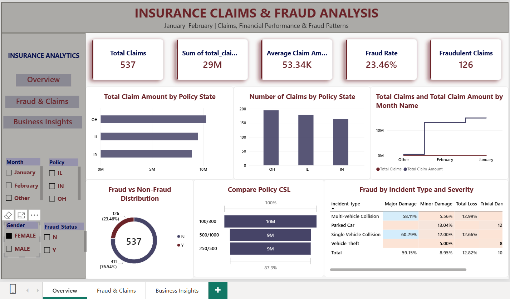
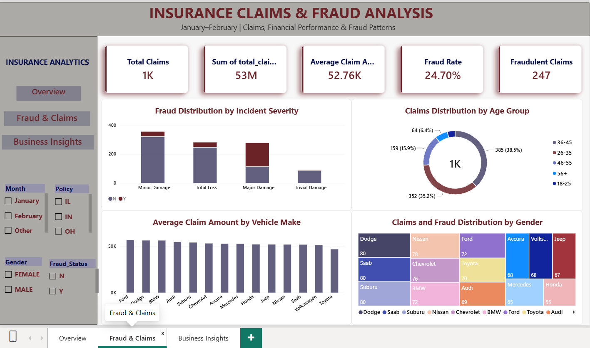
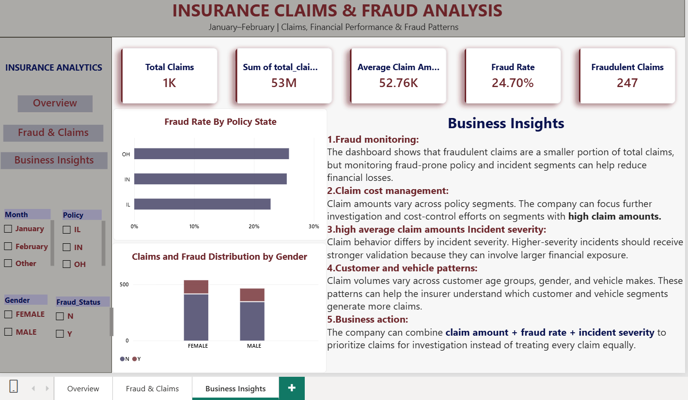

# Insurance-Claims-Fraud-Analysis
This project analyzes insurance claims data using Microsoft Power BI to understand claim volume, financial performance, fraud patterns, customer demographics, and vehicle-related claim behavior.

##  Project Overview

This project analyzes insurance claims data using **Microsoft Power BI** to understand claim volume, financial performance, fraud patterns, customer demographics, and vehicle-related claim behavior.

The dashboard transforms raw insurance claim data into an interactive business intelligence solution that helps identify **high-cost claims, fraud-prone segments, and important claim patterns**.

> This project was completed as part of a Power BI assessment and developed as a portfolio project to demonstrate practical data analytics and visualization skills.


##  Business Problem

Insurance companies handle a large number of claims with different financial values, customer characteristics, policy details, incident types, and fraud statuses.

The objective of this project is to:

- Monitor overall claim performance
- Analyze total and average claim amounts
- Compare claim trends across January and February
- Identify fraud patterns
- Analyze claims across policy segments
- Understand customer demographic patterns
- Analyze vehicle-related claim behavior
- Provide actionable business insights


##  Dashboard Preview

### Overview Dashboard



### Fraud & Claims Dashboard



### Business Insights Dashboard


##  Dataset

The dataset contains:

- **1,000 insurance claims**
- **40+ attributes**
- Customer information
- Policy information
- Incident details
- Claim financial information
- Vehicle information
- Fraud status

### Important Features

| Category | Examples |
|---|---|
| Policy | Policy State, Policy CSL, Deductible, Annual Premium |
| Customer | Age, Gender, Education, Occupation |
| Incident | Incident Type, Severity, State, City |
| Claims | Total Claim Amount, Injury Claim, Property Claim, Vehicle Claim |
| Vehicle | Auto Make, Auto Model, Auto Year |
| Fraud | Fraud Reported |


##  Tools & Technologies

- **Power BI**
- **Power Query**
- **DAX**
- **Data Cleaning**
- **Data Transformation**
- **Data Visualization**
- **Business Intelligence**


##  Project Workflow

```text
Raw Dataset
     ↓
Data Cleaning
     ↓
Data Transformation
     ↓
Data Type Correction
     ↓
Missing Value Handling
     ↓
DAX Measures
     ↓
Data Visualization
     ↓
Interactive Dashboard
     ↓
Business Insights
```


##  Data Preparation

The dataset was prepared using Power Query.

Key activities included:

- Correcting data types
- Handling missing values
- Cleaning categorical fields
- Creating month-related fields
- Creating age groups
- Preparing data for visualization
- Checking inconsistencies in the dataset

---

##  DAX Measures

### Total Claims

```DAX
Total Claims =
COUNTROWS('Insurance')
```

### Total Claim Amount

```DAX
Total Claim Amount =
SUM('Insurance'[total_claim_amount])
```

### Average Claim Amount

```DAX
Average Claim Amount =
AVERAGE('Insurance'[total_claim_amount])
```

### Fraudulent Claims

```DAX
Fraudulent Claims =
CALCULATE(
    COUNTROWS('Insurance'),
    'Insurance'[fraud_reported] = "Y"
)
```

### Fraud Rate

```DAX
Fraud Rate =
DIVIDE(
    [Fraudulent Claims],
    [Total Claims],
    0
)
```

##  Dashboard Features

### 1️ Overview Dashboard

The overview page provides:

- Total Claims
- Total Claim Amount
- Average Claim Amount
- Fraud Rate
- January vs February claim trends
- Policy-level claim analysis
- Overall financial performance

### 2️ Fraud & Claims Dashboard

The second page focuses on:

- Fraud vs Non-Fraud claims
- Fraud rate by policy state
- Fraud distribution by incident severity
- Fraud rate by incident type and severity
- Claims by age group
- Claims by gender
- Claims by vehicle make
- Average claim amount by vehicle make


##  Interactive Features

The dashboard includes slicers for:

- **Month**
- **Gender**
- **Policy State**
- **Fraud Status**

Users can interact with these filters to dynamically analyze different claim segments.

The dashboard also includes **page-navigation buttons** for easy movement between the two report pages.


##  Business Insights

The analysis helps the insurance company:

- Identify high-cost claim segments
- Monitor fraud-prone segments
- Understand claim behavior across customer demographics
- Compare financial performance across policy segments
- Analyze claim patterns by incident severity
- Identify vehicle categories with higher claim volumes
- Prioritize suspicious or high-value claims for further investigation


##  Project Structure

```text
insurance-claims-fraud-analysis-powerbi/
│
├── Dataset/
│   └── insurance_claims.csv
│
├── PowerBI/
│   └── Insurance_Claims_Analysis.pbix
│
├── Screenshots/
│   ├── overview_dashboard.png
│   └── fraud_claims_dashboard.png
│
├── Insurance_Claims_Fraud_Analysis_Project_Report
├── README.md
└── .gitignore
```


##  Key Learning Outcomes

Through this project, I strengthened my practical skills in:

- Power BI dashboard development
- Power Query data cleaning
- DAX measure creation
- KPI development
- Data visualization
- Interactive report design
- Fraud and financial analysis
- Business-oriented storytelling with data

## 👩‍💻 Author

**Prajakta Bhondave**

Aspiring Data Analyst | SQL | Power BI | Python | Excel | Data Visualization
